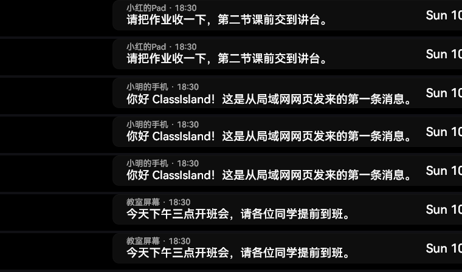
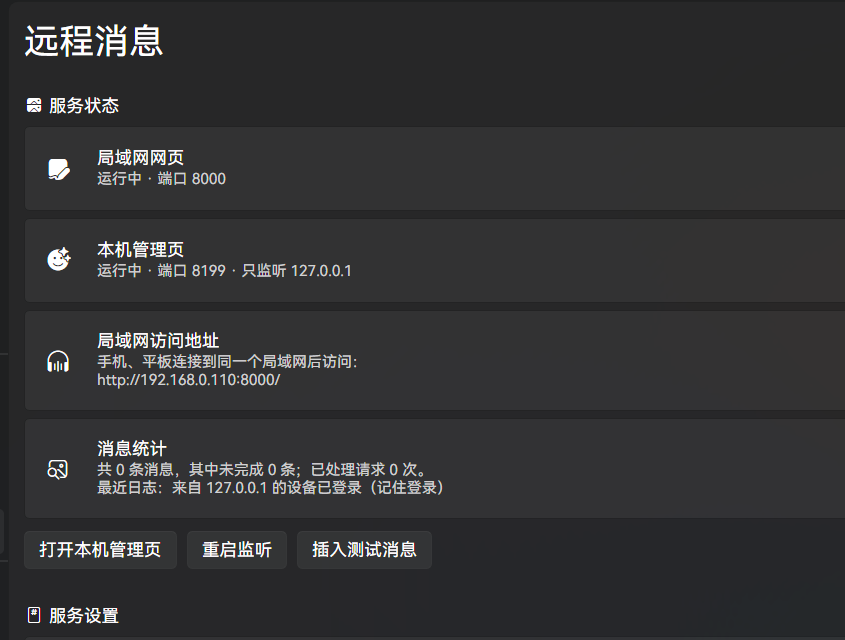
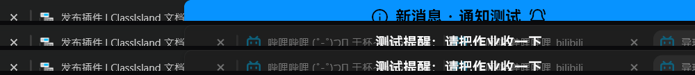
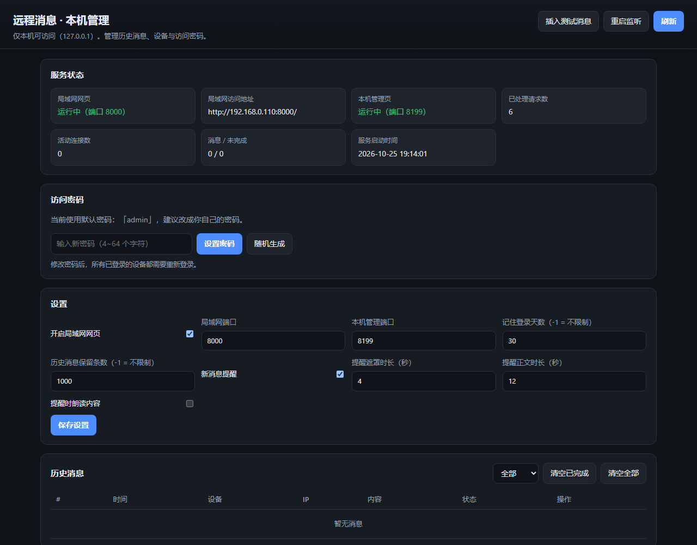

# RemoteCall · ClassIsland 局域网消息插件

> 让同一个局域网里的手机 / 平板 / 其它电脑通过网页给**本机 ClassIsland** 发消息，
> 消息以**主界面组件**轮流展示，并在收到时弹出 **ClassIsland 标准提醒**（遮罩 + 正文涟漪动画）。

| 主界面组件（每 5 秒上滑切换） | 应用设置页 |
|---|---|
|  |  |

| 提醒：遮罩 / 正文（正文静止） | 本机管理页 |
|---|---|
|  |  |

本目录是一个独立的插件工程（源码 + 冒烟测试 + 安装脚本），目标应用为
`E:\ClassIsland_app_windows_x64_full_folder`（ClassIsland 2.1.0.1 / net8.0 / Avalonia 11.3.17）。

---

## 1. 功能一览

| 需求 | 实现 |
|---|---|
| 局域网开端口给其它设备访问 | `TcpListener` 自研 HTTP/1.1 服务，监听 `0.0.0.0:8000`（端口可改） |
| 访问需要密码、可记住登录 | PBKDF2-SHA256 密码哈希 + `HttpOnly` 会话 Cookie；「记住我」按天数保留（默认 30 天，填 `-1` 表示不限制），会话持久化到磁盘 |
| 历史消息保留上限 | 默认保留最近 1000 条，填 `-1` 表示不限制（全部保留） |
| 其它设备发文字消息到本机 | 网页输入框 → `POST /api/messages` |
| 本机以组件形式展示 | 「远程消息」主界面组件（`ComponentBase<T>`），读取本地消息存储 |
| 多条消息轮流展示 | 一屏显示一条（内容垂直居中），**每 5 秒向上滑动切换**到下一条，循环播放；间隔/动画时长/高度可调 |
| 网页可看历史 + 发送者 IP + 设备名 | 历史列表按 `deviceName`、`ip`、时间、状态展示；筛选「全部 / 未完成 / 已完成」 |
| 设备名默认自动识别 | 首次访问按 User-Agent 取设备名（`iPhone` / `iPad` / Android 机型如 `SM-G991B`、`Pixel 7` / `Windows 电脑` / `Mac` / `Linux 设备`…），点一下即可改成自己的名字 || 设备名可改且历史同步改名 | 消息只存 `deviceId`，设备名单独存一张表，展示时联查 ⇒ 改名后历史立即更新 |
| 设备可标记「完成展示」 | `POST /api/messages/{id}/complete`，本机存储同步标记；组件默认只轮播未完成消息 |
| 本机 localhost 管理历史与密码 | `http://127.0.0.1:8199/`（只绑定回环地址）：历史增删、设备改名、改密码、改端口 |
| 历史同时含已完成 / 未完成 | 存储中统一保存，仅用 `completed` 区分；组件是否显示已完成为可选项 |
| 端口 / 密码在 ClassIsland 中可改 | 应用设置 →「远程消息」页面，保存后 0.3 秒内热切换监听 |
| 新消息提醒动画（类似上下课提醒） | 注册 `NotificationProviderBase`：遮罩阶段显示「新消息 · 设备名」（带涟漪特效），之后的正文**静止显示**消息内容 |

---

## 2. 目录结构

```
RemoteCall/
├─ RemoteCall.sln
├─ src/RemoteCall/                     # 插件工程（net8.0，仅依赖 ClassIsland.PluginSdk）
│  ├─ RemoteCall.csproj  manifest.yml  icon.png  README.md
│  ├─ Plugin/                          # 插件入口与标识
│  ├─ ClassIsland/                     # 组件 / 组件设置控件 / 设置页 / 提醒提供方（C# 构建 UI）
│  └─ Core/                            # ★ 不依赖 ClassIsland / Avalonia，可单独测试
│     ├─ Http/                         # 自研 HTTP/1.1 服务器（TcpListener）
│     ├─ Config/                       # 设置模型、原子 JSON 读写
│     ├─ Auth/                         # PBKDF2 密码哈希、会话存储
│     ├─ Data/                         # 消息 / 设备存储（MessageStore）
│     ├─ Server/                       # 两个服务的路由、状态、生命周期
│     └─ Web/lan|admin/                # 内嵌网页（html/css/js，无外部 CDN）
├─ tests/RemoteCall.SmokeTests/        # 无 GUI 冒烟测试（直接编译 Core，零第三方依赖）
└─ scripts/install.ps1                 # 构建 + 复制到 data\Plugins\remote.call
```

---

## 3. 构建、测试与安装

```powershell
# 构建（Release 会同时生成插件包 src\RemoteCall\cipx\RemoteCall.cipx + checksums.md）
dotnet build RemoteCall.sln -c Release

# 冒烟测试（21 项：密码/默认密码/局域网地址过滤/设备名识别/会话/限流/消息/改名/完成/管理页/HTTP 协议/存储裁剪）
dotnet run --project tests\RemoteCall.SmokeTests -c Release

# 安装到 ClassIsland（构建 + 复制文件）
pwsh -File scripts\install.ps1

# 顺便把组件插到主界面第一行（会先备份 Default.json，需先关闭 ClassIsland）
pwsh -File scripts\install.ps1 -AddComponent
```

安装后**重启 ClassIsland**，插件才会加载。

### 打包与发布

- `dotnet build src\RemoteCall\RemoteCall.csproj -c Release` 会调用 SDK 的 `CreateCipx` 目标，输出
  `src\RemoteCall\cipx\RemoteCall.cipx`（zip 格式，含 `manifest.yml` / `RemoteCall.dll` / `icon.png` / `README.md`）和
  `cipx\checksums.md`（`<!-- CLASSISLAND_PKG_MD5 {...} -->`）。
- 发布到 GitHub Release：tag 必须严格是 `a.b.c.d`（如 `1.0.0.0`），上传 `RemoteCall.cipx`，
  并把 `checksums.md` 里的那行 MD5 注释放进 Release 说明（索引生成器据此校验）。
- 上架插件市场：把 [`publish/remote.call.yml`](publish/remote.call.yml) 更名为 `remote.call.yml`，
  提交到 [ClassIsland/PluginIndex](https://github.com/ClassIsland/PluginIndex) 的 `index/plugins-v2/` 并发起 PR。
  详见官方文档 <https://docs.classisland.tech/dev/plugins/publishing.html>。

---

## 4. 使用

1. 启动 ClassIsland → 应用设置 →「远程消息」。
2. 默认访问密码是 **`admin`**（首次启动自动设置，页面会显示出来；强烈建议改成自己的密码，也可以点「随机生成」）。
3. 应用设置 →「组件」，把「远程消息」拖到主界面（或用 `install.ps1 -AddComponent` 自动插入）。
4. 手机连同一个局域网，访问页面「服务状态 → 局域网访问地址」里给出的地址（默认端口 8000），用 `admin` 登录。
5. 首次打开时设备名会**自动识别**（`iPhone` / `iPad` / Android 机型 / `Windows 电脑`…），不再显示「未命名设备」。
6. 在网页上发消息 → 主界面组件出现内容 → 同时弹出 ClassIsland 全屏提醒。
7. 网页上「标记完成」→ 本机同步标记，组件不再轮播该条（历史里仍然保留）。
8. 点顶部「设备：xxx」可以改成自己的名字，历史里该设备的消息会一起改名。

### 防火墙

首次监听时 Windows 可能弹出防火墙提示，选择「允许访问」（专用网络）。
也可以用管理员 PowerShell 手动放行：

```powershell
New-NetFirewallRule -DisplayName 'ClassIsland RemoteCall' -Direction Inbound `
  -Program 'E:\ClassIsland_app_windows_x64_full_folder\ClassIsland.exe' -Action Allow -Profile Private
```

---

## 5. 文件与数据

插件运行时的数据在 `<ClassIsland>\data\Config\Plugins\remote.call\`：

| 文件 | 内容 |
|---|---|
| `settings.json` | 端口、`LanEnabled`、密码盐/哈希、会话天数（`-1` = 不限制）、提醒设置、保留条数（`-1` = 不限制）、`GeneratedPassword`（默认密码明文，改密后清空） |
| `store.json` | `Devices[]`（id/name/lastIp/…）+ `Messages[]`（id/text/deviceId/ip/createdAt/completed） |
| `sessions.json` | 会话（只存令牌的 SHA256、到期时间、最后 IP） |

字段都是 PascalCase，可直接手改（改完重启 ClassIsland 生效）。

---

## 6. HTTP 接口速查

**局域网服务（`0.0.0.0:8000`，除登录/静态资源外都要会话 Cookie）**

| 方法 | 路径 | 说明 |
|---|---|---|
| GET | `/` `/login` `/app.js` `/style.css` | 页面与静态资源 |
| POST | `/api/login` | `{password, remember}` → `Set-Cookie: remotecall_session=…` |
| POST | `/api/logout` | 注销 |
| GET | `/api/session` | 当前会话、来源 IP、消息计数 |
| GET | `/api/messages?filter=all\|pending\|done&limit=200` | 历史消息（新→旧） |
| POST | `/api/messages` | `{text, deviceId, deviceName}` |
| POST | `/api/messages/{id}/complete` | `{completed:true/false}` |
| GET | `/api/devices` / PUT `/api/devices/{id}` | 设备列表 / 改名 `{name, requesterId}` |
| GET | `/api/health` | 健康检查 |

**本机管理服务（`127.0.0.1:8199`，无需密码，拒绝非回环来源）**

| 方法 | 路径 | 说明 |
|---|---|---|
| GET | `/api/state` | 状态 + 设置 + 消息 + 设备 + 日志 |
| POST | `/api/settings` | 改端口 / 开关 / 时长 / 保留条数 |
| POST | `/api/password`、`/api/password/generate` | 设置 / 生成访问密码（改密后清空所有会话） |
| POST | `/api/messages/{id}/complete`、`/delete`、`/api/messages/clear` | 消息操作 |
| PUT | `/api/devices/{id}` | 设备改名 |
| POST | `/api/servers/restart`、`/api/selftest` | 重启监听 / 插入测试消息 |

---

## 7. 设计说明（为什么这么做）

- **不用 `HttpListener`**：Windows 上监听 localhost 以外的前缀需要管理员权限或 `netsh http add urlacl`；
  ASP.NET Core 的共享框架又不在 ClassIsland 的 `runtimeconfig.json` 里。
  所以 `Core/Http/HttpServer.cs` 用 `TcpListener` 手写了 HTTP/1.1 子集（keep-alive、`Content-Length`、
  Cookie、ETag/304、413/405/429 等），普通权限即可监听 `0.0.0.0`。
- **不用 XAML**：插件侧的 Avalonia XAML 编译链在第三方工程里容易出问题；
  `ClassIsland/` 下所有界面都用 C# 构建 Avalonia 控件，构建稳定、无额外依赖。
- **Core 与宿主解耦**：`Core/` 不引用 ClassIsland / Avalonia，冒烟测试直接编译同一批源码，
  能在不启动 GUI 的情况下验证鉴权、限流、消息、改名、管理页与 HTTP 协议细节。
- **插件不携带 ClassIsland/Avalonia 副本**：`PackageReference` 用 `ExcludeAssets="runtime; native"`，
  运行期全部从宿主加载，避免 `AssemblyLoadContext` 类型冲突。

---

## 8. 已知限制

- 网页是**明文 HTTP**，仅适合可信局域网，不要把端口映射到公网。
- 端口改动时旧连接会断开，需要用新地址重新打开页面。
- 设备身份依赖浏览器 localStorage 的 UUID：清理浏览器数据会被当成新设备。
- 浏览器出于隐私**不提供主机名/设备名**，默认设备名是按 User-Agent 推出来的（iOS 只能区分 iPhone/iPad，Android 一般能拿到机型）；想精确区分请点一下改名。
- 安卓浏览器切到「桌面版网站」后 UA 会变成 `X11; Linux x86_64`（不含 `Android`），这时会结合 `Mobile`/`wv)`、`navigator.platform`（`Linux armv8l`）以及触屏/屏幕宽度来判定为安卓设备。
- 自动识别的名字会在每次打开页面时按当前 UA 校正；**一旦你手动改过名，就不再被自动覆盖**（`nameSource` 记为 `user`）。设备名识别异常时，管理页「最近日志」里会记录该设备本次的 User-Agent，方便排查。
- 首次启动的默认密码是 `admin`，为了便于查看会明文保存在 `settings.json` 的 `GeneratedPassword` 里；设置自己的密码后会被清空。
- 「局域网访问地址」只列出**真实网卡**的地址：VMware / Hyper-V / VirtualBox / Radmin / Tailscale / WSL / Docker 等虚拟网卡会被过滤掉（这些地址手机连不上）。如果一个可用地址都没有，会退回到列出全部候选。
- 组件默认「一屏一条、每 5 秒上滑切换、最新优先」，均可在组件设置里调整；显示高度不要超过主界面那一行的高度，否则会被裁掉。
- 「记住登录天数」填 `-1` 时服务端会话永不过期；但浏览器对 Cookie 有效期通常有约 400 天的上限，所以 Cookie 按 400 天写入，到期后需要重新登录一次。
- 「历史保留条数」填 `-1` 时会一直保留全部历史；消息很多时 `store.json` 会持续变大（每条几十字节），一般不需要担心。

## 9. 排错

| 现象 | 处理 |
|---|---|
| 应用设置里没有「远程消息」 | 插件没加载：看 `<ClassIsland>\data\Logs\*.log` 是否有插件加载错误；确认 `data\Plugins\remote.call\manifest.yml` 存在且没有 `.disabled` 文件 |
| 端口没监听 | 设置页看「服务状态」的红字原因（端口被占用等），换端口或结束占用进程 |
| 手机打不开网页 | 确认同一局域网、防火墙放行；地址请用「服务状态 → 局域网访问地址」里的那条（虚拟网卡地址会被自动过滤），必要时手动输入 `http://<电脑局域网IP>:8000/` |
| 组件不显示消息 | 确认组件已放到主界面；消息是否已被标记完成（组件默认不显示已完成） |
| 没有提醒动画 | 设置页「新消息提醒」是否开启；ClassIsland 自身提醒设置里该提供方是否被关闭 |
